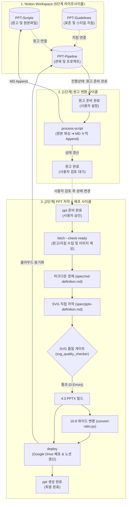

# 📊 SB-Make-Automation (Notion-to-PPT Pipeline)

> **노션(Notion)에 등록된 다양한 원고와 재활용 가능한 디자인 지침을 결합하여 고품질 PPTX를 자동 생성하고, 구글 드라이브 동기화 및 노션 결과를 실시간 업데이트하는 단일 표준 자동화 파이프라인**

[](https://www.python.org/)
[](LICENSE)
[](#)
[](https://developers.notion.com/)
[](#)

---

## 🌟 주요 특징 (Key Features)

- **📝 노션(Notion) 중심의 단일 파이프라인 관제**
  - 로컬 파일 수동 조작 없이 노션 3대 데이터베이스(`PPT-Pipeline`, `PPT-Scripts`, `PPT-Guidelines`)에서 원고 등록, 상태 변경 및 결과 확인까지 일괄 제어
- **🔄 다양한 원본 원고 포맷 자동 파싱**
  - HWP, HWPX, DOCX, PPTX, PDF 등 다양한 형식의 원본 문서를 순수 파이썬 파서(`doc_parser.py`)를 통해 마크다운으로 자동 변환하고 버전별 누적(Append) 보존
- **🎨 모듈화된 비주얼 디자인 지침 (Guidelines)**
  - 대학 표준 강의 헤더 규격부터 5대 비주얼 스타일(스위스 미니멀, 다크 테크, 소프트 라운디드, MBB 컨설팅, 클래식 칠판)을 레고 블록처럼 선택 결합
- **🖼️ S3 이미지 영구 캐싱**
  - 노션 본문에 첨부된 일회성 만료 링크(S3)를 로컬(`md/<프로젝트명>/`)에 영구 파일로 자동 다운로드하고 상대 경로로 치환하여 깨짐 없는 이미지 보존
- **📐 SVG 기반 벡터 저작 & 엄격한 품질 게이트 (Quality Gate)**
  - PPT-Master 엔진을 기반으로 슬라이드를 벡터 SVG로 직접 저작하며, 뷰박스(960x720), 명도 대비(4.5:1 이상), 폰트 크기 규격을 자동 검사하여 결함 없는 슬라이드 보장
- **🖥️ 4:3 표준 및 16:9 와이드 듀얼 포맷 자동 생성**
  - 4:3 기본형 슬라이드 빌드 후, 와이드 변환 스크립트(`convert-ratio.py`)를 통해 16:9 와이드 버전(`-169.pptx`)을 원클릭으로 동시 생성
- **☁️ Google Drive 클라우드 자동 동기화**
  - 생성된 산출물은 로컬 마운트된 Google Drive의 `<프로젝트명>/` 폴더로 자동 복사되어 즉시 클라우드 공유 및 백업

---

## 🏗️ 시스템 아키텍처 (Architecture)



---

## 💻 요구 사항 (Prerequisites)

이 프로젝트를 실행하기 위해 아래 프로그램과 환경이 필요합니다:

1. **Python**: Python 3.10 이상 (Python 3.10 ~ 3.13 권장)
2. **Git**: 프로젝트 버전 관리 및 동기화 도구
3. **Notion API Integration Token**:
   - Notion 통합을 생성하고 대상 대시보드 페이지(`NOTION-PPT`)에 연결 권한을 부여해야 합니다.
4. **Google Drive 데스크톱 앱**:
   - 로컬 디렉터리에 Google Drive가 마운트되어 있어야 자동 동기화가 동작합니다 (기본 설정: `G:\내 드라이브\Works_attach\NOTION-PPT`).

---

## 📦 설치 방법 (Installation)

### 1. 저장소 복제 (Clone)
```bash
git clone https://github.com/ssiwonk/SB-Make-Automation.git
cd SB-Make-Automation
```

### 2. 파이썬 가상환경 생성 및 활성화
```bash
# 가상환경 생성
python -m venv .venv

# 가상환경 활성화 (Windows PowerShell)
.venv\Scripts\Activate.ps1

# 가상환경 활성화 (macOS / Linux)
source .venv/bin/activate
```

### 3. 필수 의존성 패키지 설치
```bash
pip install -r requirements.txt
```

---

## ⚙️ 환경 설정 (Configuration)

프로젝트 루트의 `.env.example`을 복사하여 `.env` 파일을 생성하고 본인의 노션 통합 토큰을 설정합니다:

```bash
# Windows PowerShell
Copy-Item .env.example .env

# macOS / Linux
cp .env.example .env
```

`.env` 파일을 열고 노션 API 토큰을 입력합니다:
```env
NOTION_TOKEN=ntn_your_actual_notion_integration_token_here
```
> **보안 주의사항**: `.env` 파일은 `.gitignore`에 등록되어 GitHub에 커밋되지 않습니다. 개인 토큰을 소스 코드에 직접 기재하지 마세요.

---

## 🚀 빠른 시작 (Quick Start: 2단계 분리 표준)

본 파이프라인은 품질 관리를 위해 **1단계(원고 변환)**와 **2단계(PPTX 디자인)**가 완벽히 분리된 Human-in-the-Loop 구조로 동작합니다.
- **5단계 라이프사이클**: `준비 중` ➔ `원고 준비 완료` (1단계) ➔ `원고 완료` (검토) ➔ `ppt 준비 완료` (2단계) ➔ `ppt 생성 완료`
- **엄격한 안전 규칙**: 원스톱 진행은 없으며, 지정된 프로젝트의 상태가 준비되지 않았다면 *"아직 준비가 안된 것 같습니다."* 피드백 후 작업을 즉시 중단합니다.

---

### [1단계: 원고 변환 및 정제 사이클]

1. **사용자 원본 등록 및 상태 설정**:
   - `PPT-Scripts` 데이터베이스에 원본 문서(HWP/DOCX/PDF 등) 첨부
   - `PPT-Pipeline` 데이터베이스에서 항목을 생성하고 진행상태를 **`원고 준비 완료`**로 설정
2. **원고 변환 실행 (AI)**:
   ```bash
   python scripts/notion_ppt_bridge.py process-script "<프로젝트명 또는 Page ID>"
   ```
   - 첨부 파일 파싱 ➔ 지침 반영 ➔ 노션 본문 하단에 마크다운 누적 Append 및 버전 갱신
   - 완료 시 `PPT-Pipeline`의 진행상태가 **`원고 완료`**로 자동 변경됩니다.
3. **사용자 원고 검토**:
   - 노션에 생성된 마크다운을 검토하고 필요한 경우 수정합니다.

---

### [2단계: PPTX 디자인 & 클라우드 배포 사이클]

4. **사용자 개발 승인**:
   - 원고 검토가 완료되면 `PPT-Pipeline`의 진행상태를 **`ppt 준비 완료`**로 변경합니다.
5. **원고 수집 및 이미지 영구 캐싱 (AI)**:
   ```bash
   python scripts/notion_ppt_bridge.py fetch "<프로젝트명 또는 Page ID>" --check-ready
   ```
   - `ppt 준비 완료` 상태를 검증한 후, 본문 내 이미지(S3)를 `md/<프로젝트명>/`로 영구 저장하고 `_v1.md`, `_guidelines.md`를 생성합니다.
6. **PPTX 저작 및 품질 검사 (AI 어시스턴트 협업)**:
   - `spec/md-definition.md` 기반으로 2차 마크다운 정제 (`_v2.md`)
   - `ppt-master` 프로젝트 초기화 및 SVG 직접 저작
   - **SVG 품질 게이트 검증 (0 Errors 필수)**:
     ```bash
     python ppt-master/skills/ppt-master/scripts/svg_quality_checker.py <project_dir> --quick-generate --canonical-authoring --stage final --json
     ```
   - 4:3 기본형 PPTX 빌드
7. **16:9 와이드 변환본 동시 생성**:
   ```bash
   python scripts/convert-ratio.py "project/<작업폴더>/<엔진폴더>/exports/<파일명>.pptx"
   ```
8. **클라우드 배포 및 노션 최종 완료 갱신**:
   ```bash
   python scripts/notion_ppt_bridge.py deploy "<프로젝트 Page ID>" "<4:3파일경로>" "<16:9파일경로>" --status "ppt 생성 완료"
   ```
   - Google Drive의 `<프로젝트명>/` 폴더로 자동 동기화 복사
   - 노션 `진행상태`를 **`ppt 생성 완료`**로 갱신하고 `PPT결과`에 파일명 및 일시 기록

---

## 📁 디렉터리 구조 가이드 (Directory Structure)

```text
SB-Make-Automation/
├── md/                     # 노션에서 수집된 마크다운 및 이미지 로컬 캐시 폴더
├── project/                # 프로젝트별 최종 작업 산출물 아카이브 폴더
├── scripts/                # 파이프라인 핵심 자동화 스크립트
│   ├── notion_ppt_bridge.py# 노션 ↔ 로컬 ↔ 구글드라이브 연동 핵심 브릿지
│   ├── doc_parser.py       # HWP, HWPX, DOCX, PDF, PPTX 범용 텍스트 파서
│   ├── convert-ratio.py    # 4:3 ➔ 16:9 와이드 비율 변환기
│   ├── add_master_guideline.py # SCU 마스터 지침 등록 도구
│   └── seed_*.py           # 초기 지침 및 비주얼 스타일 등록 도구
├── spec/                   # 시스템 제작 규격 정의서
│   ├── md-definition.md    # 원고 Markdown 정제 및 교정 규칙
│   └── pptx-definition.md  # PPTX 디자인, 타이포그래피, 인포그래픽 규칙
├── ppt-master/             # SVG 기반 벡터 슬라이드 저작 엔진 (스킬)
├── temp/                   # AI 임시 작업용 폴더 (언제든 삭제 가능)
├── .env.example            # 환경 변수 템플릿 파일
├── requirements.txt        # 파이썬 필수 의존성 패키지 목록
├── AGENTS.md               # AI 에이전트 전용 행동 및 저작 규칙서
├── WORKFLOW.md             # 파이프라인 상세 워크플로우 가이드
└── README.md               # 프로젝트 종합 안내서 (본 문서)
```

---

## 🛠️ CLI 명령어 레퍼런스 (CLI Reference)

| 작업 목적 | 실행 명령어 | 설명 |
|---|---|---|
| **프로젝트 목록 조회** | `python scripts/notion_ppt_bridge.py list` | 5단계 라이프사이클 상태 및 현황 통계 집계 조회 |
| **[1단계] 원고 변환 파이프라인** | `python scripts/notion_ppt_bridge.py process-script "<프로젝트>"` | `원고 준비 완료` 검증 ➔ MD 변환 누적 ➔ `원고 완료`로 자동 갱신 |
| **원고 파일 단독 변환** | `python scripts/notion_ppt_bridge.py convert-script "<원고명/ID>"` | HWP/DOCX/PDF ➔ 마크다운 변환, 노션 하단 누적 및 버전 증가 |
| **[2단계] 원고/지침 수집** | `python scripts/notion_ppt_bridge.py fetch "<프로젝트>" --check-ready` | `ppt 준비 완료` 상태 검증 후 로컬 이미지 다운로드 및 `_v1.md` 생성 |
| **[2단계] 산출물 배포** | `python scripts/notion_ppt_bridge.py deploy "<ID>" "<4:3>" "<16:9>"` | Google Drive `<프로젝트>/` 복사 및 `ppt 생성 완료`로 갱신 |
| **진행상태 수동 변경** | `python scripts/notion_ppt_bridge.py update-status "<프로젝트>" "<상태>"` | `PPT-Pipeline` 항목의 진행상태를 수동으로 갱신 |
| **16:9 비율 변환** | `python scripts/convert-ratio.py "<4:3_pptx_경로>"` | 4:3 슬라이드를 16:9 와이드 슬라이드로 변환 |
| **SVG 품질 검사** | `python ppt-master/skills/ppt-master/scripts/svg_quality_checker.py ...` | SVG 뷰박스, 폰트 크기, 명도비, 레이아웃 검증 |

---

## ❓ 자주 묻는 질문 (FAQ)

### Q1. 노션 연동 시 `404 Not Found` 에러가 발생합니다.
- 노션 웹페이지에서 대상 데이터베이스의 상위 대시보드인 `NOTION-PPT` 페이지 우측 상단 `···` ➔ `연결(Connections)`에서 생성하신 노션 통합 토큰을 연결해 주세요. 하위 모든 데이터베이스에 권한이 자동 상속됩니다.

### Q2. 구글 드라이브(G: 드라이브) 경로 경고가 표시됩니다.
- Google Drive 데스크톱 앱이 실행 중인지 확인해 주세요. 드라이브 문자가 `G:`가 아닌 경우 `scripts/notion_ppt_bridge.py` 파일 상단의 `GDRIVE_LOCAL_PATH` 경로를 본인의 드라이브 마운트 경로에 맞게 변경하시면 됩니다.

---

## 📄 라이선스 (License)

본 프로젝트는 오픈소스 [MIT License](LICENSE)에 따라 자유롭게 사용 및 수정, 배포할 수 있습니다.  
본 솔루션은 오픈소스 슬라이드 저작 엔진인 [ppt-master](https://github.com/he-hugo/ppt-master)를 기반으로 확장·개발되었으며, 원작자(Hugo He)의 MIT 라이선스 규정을 준수합니다.

```text
MIT License

Copyright (c) 2026 Simon K.
Copyright (c) 2025-2026 Hugo He (ppt-master)
```
