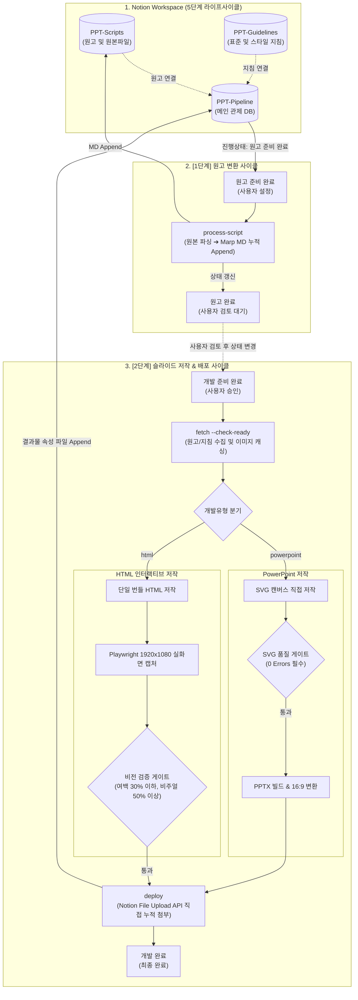

# 📊 SB-Make-Automation (Notion-to-PPT/HTML Pipeline)

> **노션(Notion)에 등록된 원고와 재활용 가능한 디자인 지침을 결합하여 고품질 PPTX 및 인터랙티브 HTML 웹 슬라이드를 자동 생성하고, 노션 결과물(Files & media) 속성에 산출물을 직접 실시간 누적(Append) 첨부하는 단일 표준 자동화 파이프라인**

[](https://www.python.org/)
[](LICENSE)
[](#)
[](https://developers.notion.com/)
[](#)
[](#)

---

## 🌟 주요 특징 (Key Features)

- **📝 노션(Notion) 중심의 단일 파이프라인 관제**
  - 로컬 파일 수동 조작 없이 노션 3대 데이터베이스(`PPT-Pipeline`, `PPT-Scripts`, `PPT-Guidelines`)에서 프로젝트 등록, 원고 변환, 품질 검증, 빌드 및 배포까지 일괄 제어
- **📎 노션 공식 File Upload API 직접 누적 첨부 (Single Source of Truth)**
  - 외부 클라우드(Google Drive 등) 의존성을 전면 배제하고, 완성된 산출물(`.pptx`, `index.html`)을 노션 공식 파일 업로드 API를 통해 `결과물` (Files & media) 속성에 직접 **누적(Append)** 보존
- **🎯 듀얼 개발 유형 지원 (PowerPoint & HTML)**
  - **`powerpoint`**: SVG 벡터 기반 고품질 프레젠테이션 (도형·텍스트 100% 네이티브 편집 가능)
  - **`html`**: Chart.js, 부드러운 순차 등장 애니메이션, Pretendard 웹폰트가 내장된 단일 파일 인터랙티브 웹 슬라이드 번들
- **📐 16:9 네이티브 & 4:3 듀얼 비율 동적 분기**
  - `16:9`: 1280×720 와이드 캔버스에 최적화된 시각화 레이아웃으로 직접 저작
  - `4:3`: 1024×768 표준 캔버스 빌드 후 와이드 변환 스크립트(`convert-ratio.py`)로 16:9 버전(`-169.pptx`) 동시 생성
- **🔄 다양한 원본 원고 포맷 자동 파싱**
  - HWP, HWPX, DOCX, PPTX, PDF 등 다양한 형식의 원본 문서를 kordoc 메인 엔진(`doc_parser.py`)을 통해 구조화된 마크다운으로 자동 추출 및 누적 보존
- **🎨 모듈화된 비주얼 디자인 지침 (Guidelines)**
  - 대학 표준 강의 규격부터 5대 비주얼 스타일(스위스 미니멀, 다크 테크, 소프트 라운디드, MBB 컨설팅, 클래식 칠판)을 자유롭게 결합
- **🖼️ 노션 S3 이미지 영구 로컬 캐싱**
  - 노션 본문에 첨부된 일회성 만료 링크(S3)를 로컬(`md/<프로젝트명>/`)에 영구 파일로 자동 다운로드하여 이미지 유실 원천 방지
- **🛡️ 3중 자동 품질 검수 게이트 (Quality Gates)**
  - **PPTX**: `svg_quality_checker.py` (0 Errors 통과 필수: 뷰박스, 명도 대비 4.5:1 이상, 텍스트 오버플로우 방지)
  - **HTML**: `capture_slides.py` (Playwright 1920×1080 실화면 자동 캡처 + 여백 점유율 30% 이하, 비주얼 스케일 50% 이상 3대 시각 비전 검증)
- **💬 버전별 피드백 격리 프로토콜 (`## <최신_파일명>`)**
  - 프로젝트 본문에 최신 결과물 파일명 헤더 하위로 슬라이드별 수정 요구사항 및 캡처 이미지를 작성하여 과거 이력과 혼선 없이 재개발 수행

---

## 🏗️ 시스템 아키텍처 (Architecture)



---

## 💻 요구 사항 (Prerequisites)

1. **Python**: Python 3.10 이상 (Python 3.12 / 3.13 권장)
2. **Node.js**: Node.js 18 또는 20 이상 (Playwright 브라우저 엔진 구동용)
3. **Git**: 프로젝트 버전 관리 도구
4. **Notion API Integration Token**:
   - [Notion Developers](https://developers.notion.com/)에서 생성한 프라이빗 내부 통합 토큰
   - 대상 대시보드 페이지(`NOTION-PPT`)에 '연결 추가(Add Connections)' 권한 부여

---

## 📦 설치 방법 (Installation)

### 1. 저장소 복제 (Clone)
```bash
git clone https://github.com/ssiwonk/SB-Make-Automation.git
cd SB-Make-Automation
```

### 2. 파이썬 가상환경 생성 및 활성화
```bash
# 가상환경 생성
python -m venv .venv

# 가상환경 활성화 (Windows PowerShell)
.venv\Scripts\Activate.ps1

# 가상환경 활성화 (macOS / Linux)
source .venv/bin/activate
```

### 3. 필수 의존성 패키지 및 브라우저 설치
```bash
# 파이썬 필수 라이브러리 설치
pip install -r requirements.txt

# HTML 비전 검증용 Playwright Chromium 브라우저 설치
npx playwright install chromium
```

---

## ⚙️ 환경 설정 (Configuration)

프로젝트 루트의 `.env.example`을 복사하여 `.env` 파일을 생성하고 노션 통합 토큰을 입력합니다:

```bash
# Windows PowerShell
Copy-Item .env.example .env

# macOS / Linux
cp .env.example .env
```

`.env` 파일 내용:
```env
NOTION_TOKEN=ntn_your_actual_notion_integration_token_here
```
> **보안 주의사항**: `.env` 파일은 `.gitignore`에 등록되어 커밋되지 않습니다. 개인 토큰을 외부에 노출하지 마세요.

---

## 🚀 빠른 시작 (Quick Start: 5단계 라이프사이클)

파이프라인은 품질 보장을 위해 **1단계(원고 변환)**와 **2단계(디자인 빌드 및 배포)**가 명확히 분리되어 운영됩니다.

| 진행 단계 | 주체 | 동작 내용 |
|---|:---:|---|
| **`Task 준비 중`** | **사람** | `PPT-Pipeline`에 프로젝트 등록, 원본파일/지침 연결, 개발유형/비율 선택 후 **`원고 준비 완료`**로 변경 |
| **`원고 준비 완료`** | **AI** | 원본 문서 파싱 ➔ Marp 마크다운 정제 ➔ `PPT-Scripts` 본문 누적 Append ➔ **`원고 완료`**로 자동 갱신 |
| **`원고 완료`** | **사람** | 마크다운 원고를 노션에서 검토/교정 후 빌드 승인(상태를 **`개발 준비 완료`**로 변경) |
| **`개발 준비 완료`** | **AI** | 최신 원고/이미지 캐싱(`fetch`) ➔ 유형별 저작 ➔ 품질 게이트 통과 ➔ 노션 `결과물` 속성 직접 첨부 ➔ **`개발 완료`**로 갱신 |
| **`개발 완료`** | **사람** | 노션에서 완성된 PPTX 또는 HTML 파일을 다운로드하여 프레젠테이션 활용 |

### [1단계: 원고 변환 명령]
```bash
python scripts/notion_ppt_bridge.py process-script "<프로젝트명 또는 Page ID>"
```

### [2단계: 슬라이드 빌드 및 배포 명령]
```bash
# 1. 데이터 수집 및 캐싱
python scripts/notion_ppt_bridge.py fetch "<프로젝트명 또는 Page ID>" --check-ready

# 2. 품질 검사 게이트
# (PPTX인 경우)
python ppt-master/skills/ppt-master/scripts/svg_quality_checker.py <project_dir> --quick-generate --canonical-authoring --stage final --json
# (HTML인 경우)
python scripts/capture_slides.py "project/<프로젝트폴더>/index.html"

# 3. 노션 결과물 속성에 직접 첨부(누적 Append) 배포
python scripts/notion_ppt_bridge.py deploy "<프로젝트 Page ID>" "<파일경로1>" "<파일경로2>" --status "개발 완료"
```

---

## 🔄 개발 후 수정 요청 방법 (Change Request Protocol)

산출물 검수 후 레이아웃이나 내용을 수정할 때는 노션 프로젝트 페이지 본문에 피드백을 작성합니다:

1. **작성 형식**: 노션 본문에 **`## <최신_결과물_파일명>`** 헤더를 두고 하위에 슬라이드별 수정 요구사항 및 캡처 이미지를 첨부합니다:
   ```markdown
   ## test_presentation_20261027_153740.pptx
   - [2번 슬라이드] 4대 핵심 축 카드의 배경색을 네온 블루(#3B82F6)로 변경
   - [4번 슬라이드] 다이어그램 화살표 두께 확대 및 텍스트 2줄 래핑 조정
   - [스크린샷 오류] 5번 슬라이드 텍스트 겹침 현상 수정 (이미지 첨부 🖼️)
   ```
2. **이력 격리**: AI는 가장 최신 파일명 헤더 하위 섹션만을 활성 피드백으로 자동 인식하며, 이전 버전의 피드백은 영구 보존됩니다.
3. **재개발 실행**: 피드백 작성 후 카드를 **`개발 완료` ➔ `개발 준비 완료`**로 변경하고 재개발을 요청하면, 수정본이 노션 `결과물`에 **누적(Append)** 첨부됩니다.

---

## 📁 디렉터리 구조 (Directory Structure)

```text
SB-Make-Automation/
├── md/                     # 노션에서 수집된 마크다운 및 S3 영구 이미지 캐시 폴더
├── project/                # 프로젝트별 최종 작업 산출물 및 빌드 폴더
├── scripts/                # 파이프라인 핵심 자동화 스크립트
│   ├── notion_ppt_bridge.py# 노션 연동 핵심 브릿지 (File Upload API 직접 연동)
│   ├── capture_slides.py   # HTML 슬라이드 실화면 자동 캡처 도구 (Playwright)
│   ├── doc_parser.py       # HWP, HWPX, DOCX, PDF, PPTX 범용 문서 파서
│   ├── convert-ratio.py    # 4:3 ➔ 16:9 와이드 비율 변환 스크립트
│   └── seed_*.py           # 초기 지침 및 비주얼 스타일 등록 도구
├── spec/                   # 시스템 표준 규격 및 사용자 문서
│   ├── user_manual.md      # 신규 사용자용 실전 종합 매뉴얼
│   ├── md-definition.md    # 원고 Markdown 정제 및 교정 규칙
│   └── pptx-definition.md  # PPTX 디자인, 타이포그래피, 인포그래픽 규칙
├── ppt-master/             # SVG 기반 벡터 슬라이드 저작 엔진 (스킬)
├── temp/                   # AI 임시 작업용 폴더 (언제든 삭제 가능)
├── .env.example            # 환경 변수 템플릿 파일
├── requirements.txt        # 파이썬 필수 의존성 패키지 목록
├── AGENTS.md               # AI 에이전트 전용 행동 및 저작 규칙서
├── WORKFLOW.md             # 파이프라인 상세 워크플로우 가이드
└── README.md               # 프로젝트 종합 안내서 (본 문서)
```

---

## 🛠️ CLI 명령어 레퍼런스 (CLI Reference)

| 작업 목적 | 실행 명령어 | 설명 |
|---|---|---|
| **프로젝트 목록 조회** | `python scripts/notion_ppt_bridge.py list` | 5단계 라이프사이클 상태 및 현황 통계 집계 조회 |
| **[1단계] 원고 변환 파이프라인** | `python scripts/notion_ppt_bridge.py process-script "<프로젝트>"` | `원고 준비 완료` 검증 ➔ MD 변환 누적 ➔ `원고 완료`로 자동 갱신 |
| **원고 파일 단독 변환** | `python scripts/notion_ppt_bridge.py convert-script "<원고명/ID>"` | HWP/DOCX/PDF ➔ 마크다운 변환, 노션 하단 누적 및 버전 증가 |
| **[2단계] 원고/지침 수집** | `python scripts/notion_ppt_bridge.py fetch "<프로젝트>" --check-ready` | `개발 준비 완료` 상태 검증 후 로컬 이미지 다운로드 및 `_v1.md` 생성 |
| **[2단계] 산출물 배포** | `python scripts/notion_ppt_bridge.py deploy "<ID>" "<파일1>" "<파일2>"` | 노션 `결과물` (Files & media) 속성에 직접 파일 첨부(누적) 및 `개발 완료`로 갱신 |
| **HTML 실화면 캡처** | `python scripts/capture_slides.py "project/<폴더>/index.html"` | 1920×1080 와이드 고정 뷰포트에서 전체 슬라이드 자동 캡처 |
| **진행상태 수동 변경** | `python scripts/notion_ppt_bridge.py update-status "<프로젝트>" "<상태>"` | `PPT-Pipeline` 항목의 진행상태를 수동으로 갱신 |
| **16:9 비율 변환** | `python scripts/convert-ratio.py "<4:3_pptx_경로>"` | 4:3 슬라이드를 16:9 와이드 슬라이드로 변환 |
| **SVG 품질 검사** | `python ppt-master/skills/ppt-master/scripts/svg_quality_checker.py ...` | SVG 뷰박스, 폰트 크기, 명도비, 레이아웃 검증 (0 Errors 통과 필수) |

---

## ❓ 자주 묻는 질문 (FAQ)

### Q1. 노션 연동 시 `404 Not Found` 또는 `Object not found` 에러가 발생합니다.
- 노션 웹페이지에서 대상 데이터베이스의 상위 대시보드인 `NOTION-PPT`(`3fa624a3-5444-80bc-98f0-e9ba0624d2e2`) 페이지 우측 상단 `···` ➔ `연결(Connections)`에서 생성하신 노션 통합 토큰(봇)을 연결해 주세요. 하위 모든 데이터베이스에 권한이 자동 상속됩니다.

### Q2. 구글 드라이브 동기화는 지원되지 않나요?
- 본 파이프라인은 버전 혼선 방지와 단일 데이터 원천(Single Source of Truth) 원칙에 따라 구글 드라이브/외부 클라우드 동기화를 전면 배제하고, 노션 공식 File Uploads API를 통해 `결과물` 속성에 완성 파일(`.pptx`, `index.html`)을 직접 영구 누적(Append) 첨부합니다.

### Q3. HTML 슬라이드에서 글자가 겹치거나 여백이 휑하게 비어 보입니다.
- HTML 슬라이드는 배포 전 반드시 `python scripts/capture_slides.py`를 실행하여 1920×1080 해상도 실화면 스크린샷을 생성한 뒤, **여백 점유율 30% 이하**, **비주얼 스케일 50% 이상**의 3대 비전 검증 기준을 통과해야 배포할 수 있습니다.

---

## 📄 라이선스 (License)

본 프로젝트는 오픈소스 [MIT License](LICENSE)에 따라 자유롭게 사용 및 수정, 배포할 수 있습니다.  
본 솔루션은 오픈소스 슬라이드 저작 엔진인 [ppt-master](https://github.com/he-hugo/ppt-master)를 기반으로 확장·개발되었으며, 원작자(Hugo He)의 MIT 라이선스 규정을 준수합니다.

```text
MIT License

Copyright (c) 2026 Simon K.
Copyright (c) 2025-2026 Hugo He (ppt-master)
```
