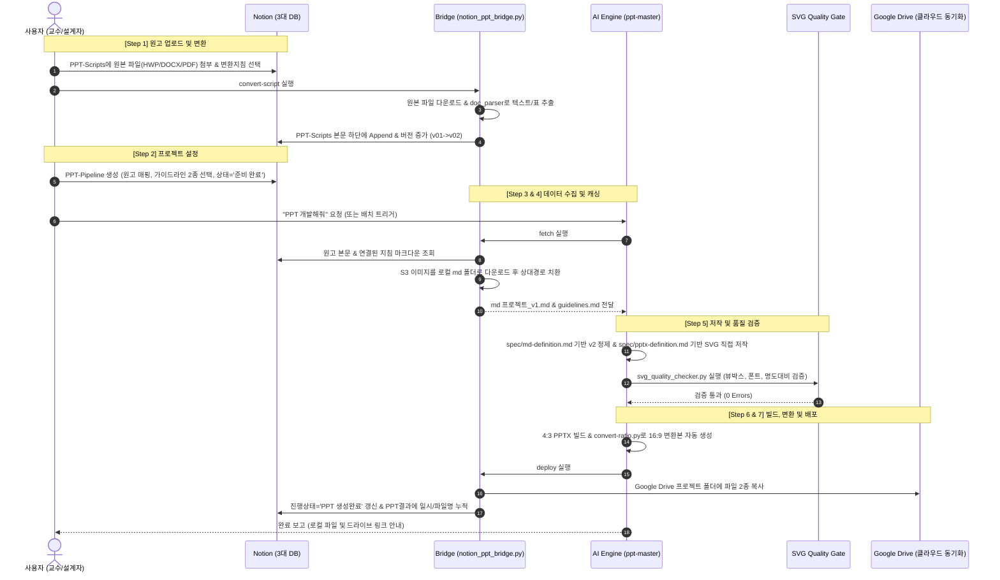

# 📘 NOTION-PPT 파이프라인 워크플로우 가이드 (Workflow Guide)

본 문서는 **SB-Make-Automation** 프로젝트의 **단일 표준 노션 연동 PPTX 자동화 파이프라인(Notion-to-PPT Pipeline)**에 대한 종합 가이드입니다.
모든 슬라이드 제작 및 변환 작업은 오직 노션을 통해서만 이루어지며, 본 문서에는 전체 시스템 아키텍처, 단계별 실행 절차, SVG 품질 검사 규격, 명령어 레퍼런스 및 트러블슈팅이 포함되어 있습니다.

---

## 📑 목차
1. [시스템 개요 및 핵심 원칙](#1-시스템-개요-및-핵심-원칙)
2. [시스템 아키텍처 및 디렉터리 구조](#2-시스템-아키텍처-및-디렉터리-구조)
3. [단일 표준 워크플로우: Notion-to-PPT 파이프라인](#3-단일-표준-워크플로우-notion-to-ppt-파이프라인)
4. [SVG 품질 검사 게이트 규격 (Quality Gate)](#4-svg-품질-검사-게이트-규격-quality-gate)
5. [명령어 치트시트 (CLI Cheatsheet)](#5-명령어-치트시트-cli-cheatsheet)
6. [자주 묻는 질문 및 트러블슈팅 (FAQ)](#6-자주-묻는-질문-및-트러블슈팅-faq)

---

## 1. 시스템 개요 및 핵심 원칙

### 🎯 핵심 원칙
> **"모든 PPTX 생성 및 변환 작업은 오직 노션(Notion) 파이프라인을 통해서만 수행됩니다."**
> 로컬 파일 직접 투입 방식은 전면 배제되며, 원고 등록부터 지침 매핑, 상태 관제, 최종 클라우드 배포까지 모든 과정이 노션과 구글 드라이브 중심으로 완전 자동화됩니다.

### 🌟 핵심 가치
- **Notion 기반 통합 관제**: 웹/모바일 어디서든 원본 파일 등록, 가이드라인 조합, 실시간 상태 변경 가능
- **재활용 가능한 디자인 지침 (Guidelines)**: 대학 표준 헤더 규격, 5대 비주얼 스타일(스위스 미니멀, 다크 테크 등)을 레고 블록처럼 조합 적용
- **이미지 영구 캐싱 및 링크 치환**: 노션의 일회성 S3 이미지를 로컬에 자동 다운로드하여 만료 없는 안전한 슬라이드 제작 보장
- **SVG 기반 고품질 저작 & 품질 게이트**: 벡터 기반 SVG 직접 저작 및 엄격한 품질 검사(`svg_quality_checker.py`) 통과 후 PPTX 빌드
- **듀얼 포맷 자동 생성 & 클라우드 배포**: 4:3 표준 슬라이드 빌드 후 16:9 와이드 변환본을 동시 생성하여 구글 드라이브 프로젝트 폴더에 자동 동기화

---

## 2. 시스템 아키텍처 및 디렉터리 구조

### 2.1 로컬 작업 디렉터리
```text
SB-Make-Automation/
├── md/                     # 노션에서 수집된 마크다운 및 영구 캐싱된 이미지
│   ├── <프로젝트명>_v1.md    # 노션 원고 초안 마크다운
│   ├── <프로젝트명>_v2.md    # 교수설계 표준 반영 최종 정제본
│   ├── <프로젝트명>_guidelines.md # 결합된 개발지침 마크다운
│   └── <프로젝트명>/         # 문서 내 포함된 이미지 파일 보관 폴더
├── project/                # 프로젝트별 최종 산출물 아카이브
│   └── YYMMDDHHMM_<이름>/   # 타임스탬프별 독립 작업 폴더
│       ├── final_<이름>.md  # 최종 확정 마크다운 사본
│       └── <ppt-master-pj>/ # ppt-master 엔진 프로젝트 (SVG 저작물 일체)
│           └── exports/     # 최종 PPTX 파일 (4:3 기본 및 16:9 변환본)
├── scripts/                # 파이프라인 자동화 핵심 도구
│   ├── notion_ppt_bridge.py# 노션 ↔ 로컬 ↔ 구글드라이브 연동 브릿지 컨트롤러
│   ├── convert-ratio.py    # 4:3 PPTX ➔ 16:9 와이드 변환 스크립트
│   └── doc_parser.py       # HWP, HWPX, DOCX, PDF, PPTX 범용 텍스트 파서
├── spec/                   # 정제 및 저작 규칙 정의서
│   ├── md-definition.md    # 원고 Markdown 정제 및 교정 규칙 정의서
│   └── pptx-definition.md  # PPTX 디자인, 타이포그래피, SVG 제작 규칙 정의서
├── ppt-master/             # SVG 기반 벡터 슬라이드 저작 엔진 (스킬)
├── temp/                   # 순수 임시 작업 폴더 (언제든 삭제 가능)
├── AGENTS.md               # AI 에이전트 공통 행동 규칙 및 시스템 명세서
└── WORKFLOW.md             # 파이프라인 종합 워크플로우 가이드 (본 문서)
```

### 2.2 노션 데이터베이스 및 구글 드라이브 환경
- **상위 대시보드 페이지**: `NOTION-PPT` (`3fa624a3-5444-80bc-98f0-e9ba0624d2e2`)
- **1) 메인 관제 DB (`PPT-Pipeline`)**:
  - 속성: `프로젝트`(Title), `진행상태`(Select: 준비 중 / 준비 완료 / PPT 생성완료), `개발비율`(Select: 4:3 / 16:9), `원고`(Relation), `PPT개발지침`(Relation), `PPT결과`(Rich Text), `메모`, `최종편집일`
- **2) 원고 DB (`PPT-Scripts`)**:
  - 속성: `원고`(Title), `원본파일`(Files: HWP/HWPX/DOCX/PPTX/PDF), `원고변환지침`(Relation to PPT-Guidelines), `버전`(Select: v01~v20), `프로젝트명`(Relation to PPT-Pipeline)
  - 본문: 변환된 마크다운이 타임스탬프 헤더와 함께 **지워지지 않고 하단에 누적(Append)**되며 `버전` 속성이 자동 갱신됨
- **3) 개발지침 DB (`PPT-Guidelines`)**:
  - 속성: `개발지침`(Title), `유형`(Multi-select: SCU 표준, 원고변환, 대본형, 교재형, 비주얼 스타일 등)
  - 본문: 원고 변환 규칙, 레이아웃, 컬러 팔레트, 타이포그래피 규격
- **4) Google Drive 로컬 동기화 마운트**:
  - 경로: `G:\내 드라이브\Works_attach\NOTION-PPT\<프로젝트명>/`
  - 웹 URL: [Google Drive NOTION-PPT 폴더](https://drive.google.com/open?id=1CH7TFrOZMDKQD3SsvFWQ2Sl1sZcbWMwG&usp=drive_fs)

---

## 3. 단일 표준 워크플로우: Notion-to-PPT 파이프라인

### 3.1 전체 파이프라인 흐름도



---

### 3.2 단계별 상세 실행 절차

#### 1단계: 원고 업로드 및 자동 마크다운 변환
1. 노션 **`PPT-Scripts`** 데이터베이스에 새 항목을 추가하고 원고 제목을 입력합니다.
2. `원본파일` 속성에 HWP, HWPX, DOCX, PPTX, PDF 중 1개를 첨부합니다.
3. `원고변환지침` 속성에서 적절한 지침(예: `대본형 원고 변환 지침`, `교재형 줄글 원고 변환 지침`)을 연결합니다.
4. 터미널에서 변환 명령을 실행합니다:
   ```bash
   python scripts/notion_ppt_bridge.py convert-script "<원고명 또는 Page ID>"
   ```
5. **결과**: 노션 `PPT-Scripts` 본문 하단에 타임스탬프와 함께 변환된 마크다운이 지워지지 않고 누적(Append)되며, `버전` 속성이 `v01` ➔ `v02`로 자동 증가합니다.

#### 2단계: 프로젝트 세팅 및 지침 매핑
1. 노션 **`PPT-Pipeline`** 데이터베이스에 새 프로젝트를 등록합니다.
2. `원고` 속성에서 준비된 원고를 선택합니다.
3. `PPT개발지침` 속성에서 다음 2종을 필수로 연결합니다:
   - **기본 규격 지침**: `SCU 대학 강의용 보드 지침` (헤더 4줄 보존, 본문 폰트 규격 등)
   - **비주얼 스타일 지침**: `비주얼 스타일: 스위스 미니멀`, `소프트 라운디드`, `다크 테크`, `MBB 컨설팅`, `클래식 칠판` 중 1개 선택
4. `개발비율`을 설정합니다 (`4:3 (기본)` 또는 `16:9`).
5. `진행상태`를 **`준비 완료`**로 변경합니다.

#### 3단계: AI 개발 실행
- 사용자가 AI 어시스턴트 채팅창에 **`"<프로젝트명> PPT 개발해줘"`**라고 요청합니다.

#### 4단계: 소스 수집 및 이미지 영구 캐싱
- AI가 내부적으로 `fetch` 명령을 실행합니다:
  ```bash
  python scripts/notion_ppt_bridge.py fetch "<프로젝트명 또는 Page ID>"
  ```
- **주요 동작**:
  - 노션의 임시 S3 이미지를 로컬 `md/<프로젝트명>/` 폴더로 다운로드합니다.
  - 마크다운 링크를 로컬 상대경로로 치환하여 `md/<프로젝트명>_v1.md`로 저장합니다.
  - 연결된 개발지침들을 병합하여 `md/<프로젝트명>_guidelines.md`로 저장합니다.

#### 5단계: 마크다운 정제, SVG 저작 및 품질 검사
1. **마크다운 2차 정제**: `spec/md-definition.md`에 따라 슬라이드별 헤더와 카드 내용을 정제 (`md/<프로젝트명>_v2.md`).
2. **작업 폴더 초기화**:
   ```bash
   python ppt-master/skills/ppt-master/scripts/project_manager.py init <프로젝트명> --format ppt43 --quick-generate
   ```
3. **SVG 저작**: `spec/pptx-definition.md` 및 선택된 스타일 지침에 맞춰 슬라이드별 SVG 직접 저작.
4. **SVG 품질 검사 게이트 통과**:
   ```bash
   python ppt-master/skills/ppt-master/scripts/svg_quality_checker.py <project_dir> --quick-generate --canonical-authoring --stage final --json
   ```
   *(반드시 0 Errors 통과 확인)*

#### 6단계: PPTX 빌드 및 16:9 와이드 변환
1. 4:3 기본 PPTX 빌드 ➔ `exports/<프로젝트명>_<timestamp>.pptx` 생성.
2. 16:9 와이드 변환본 자동 생성:
   ```bash
   python scripts/convert-ratio.py "<exports_경로>/<프로젝트명>_<timestamp>.pptx"
   ```
   ➔ 동일 폴더에 `<프로젝트명>_<timestamp>-169.pptx` 생성.

#### 7단계: 구글 드라이브 배포 및 노션 상태 갱신
- AI가 배포 스크립트를 호출합니다:
  ```bash
  python scripts/notion_ppt_bridge.py deploy "<프로젝트 Page ID>" "<4:3 PPTX 경로>" "<16:9 PPTX 경로>" --status "PPT 생성완료"
  ```
- **결과**:
  - `G:\내 드라이브\Works_attach\NOTION-PPT\<프로젝트명>/` 폴더로 파일 복사 (Google Drive 자동 동기화)
  - 노션 `PPT-Pipeline`의 `진행상태`가 **`PPT 생성완료`**로 자동 갱신
  - 노션 `PPT결과` 속성에 `[YYYY-MM-DD HH:MM] <파일명.pptx>` 형태로 생성 내역 누적(Append)

---

## 4. SVG 품질 검사 게이트 규격 (Quality Gate)

모든 슬라이드는 파워포인트 빌드 전 반드시 `svg_quality_checker.py`의 엄격한 품질 게이트를 통과해야 합니다.

### 4.1 핵심 검증 항목

| 검증 항목 | 허용 기준 | 위반 시 영향 |
|---|---|---|
| **ViewBox 규격** | `0 0 960 720` (4:3 표준) | 비율 왜곡 및 오버플로우 발생 |
| **타이포그래피 선언** | `spec_lock.md`에 선언된 폰트 크기만 사용 (`px` 없는 숫자) | 미등록 폰트 크기 사용 시 렌더링 불일치 |
| **명도 대비 (Contrast)** | 배경 대비 텍스트 최소 **4.5:1** 이상 충족 | 가독성 저하 및 대학 강의 표준 미달 |
| **강의 헤더 보존** | 상단 과목명, 차시, 슬라이드 번호, 슬라이드 제목 분리 배치 | 강의 교재 표준 템플릿 훼손 |
| **카드/컴포넌트 구조** | 텍스트 단순 나열 금지, 카드/박스 형태의 인포그래픽 구성 | 슬라이드 시각화 완성도 부족 |

### 4.2 품질 검사 실행 명령어
```bash
python ppt-master/skills/ppt-master/scripts/svg_quality_checker.py \
  project/<프로젝트폴더>/<ppt-master폴더> \
  --quick-generate \
  --canonical-authoring \
  --stage final \
  --json
```
- **통과 요건**: `Errors: 0` (Warnings는 필요시 검토 후 허용)

---

## 5. 명령어 치트시트 (CLI Cheatsheet)

| 목적 | 명령어 | 설명 |
|---|---|---|
| **프로젝트 목록 조회** | `python scripts/notion_ppt_bridge.py list` | 노션 PPT-Pipeline의 모든 프로젝트 및 상태 조회 |
| **원고 파일 ➔ 마크다운 변환** | `python scripts/notion_ppt_bridge.py convert-script "<원고명/ID>"` | HWP/DOCX/PDF ➔ 마크다운 변환, 노션 하단 Append, 버전 증가 |
| **소스 수집 & 이미지 캐싱** | `python scripts/notion_ppt_bridge.py fetch "<프로젝트명/ID>"` | 노션 이미지 로컬 다운로드 및 `_v1.md`, `_guidelines.md` 생성 |
| **결과물 배포 & 노션 갱신** | `python scripts/notion_ppt_bridge.py deploy "<Page ID>" "<pptx1>" "<pptx2>"` | 구글 드라이브 `<프로젝트명>/` 폴더로 복사 및 노션 상태/결과 업데이트 |
| **4:3 ➔ 16:9 비율 변환** | `python scripts/convert-ratio.py "<4:3_pptx_경로>"` | 4:3 PPTX 슬라이드를 기반으로 16:9 와이드 슬라이드 자동 생성 |
| **SVG 품질 검사** | `python ppt-master/skills/ppt-master/scripts/svg_quality_checker.py <dir> --quick-generate --stage final` | SVG 뷰박스, 폰트 규격, 명도비, 레이아웃 검증 |

---

## 6. 자주 묻는 질문 및 트러블슈팅 (FAQ)

### Q1. 노션 연동 시 `404 Not Found` 또는 `Object not found` 에러가 발생합니다.
- **원인**: 노션 API 통합(Integration) 토큰에 해당 페이지나 데이터베이스 접근 권한이 부여되지 않았습니다.
- **해결책**:
  1. 노션 웹에서 `NOTION-PPT` 대시보드 페이지를 엽니다.
  2. 우측 상단 `···` (더보기) ➔ `연결(Connections)` 클릭.
  3. 현재 사용 중인 통합 토큰을 연결하면 하위의 `PPT-Pipeline`, `PPT-Scripts`, `PPT-Guidelines` DB가 모두 정상 접근됩니다.

### Q2. 구글 드라이브 로컬 경로를 찾을 수 없다는 경고가 뜹니다.
- **원인**: Google Drive 데스크톱 앱이 실행되지 않았거나 마운트 드라이브가 `G:`가 아닙니다.
- **해결책**:
  - Google Drive 데스크톱 앱이 백그라운드에서 정상 실행 중인지 확인합니다.
  - 마운트 드라이브 문자가 다른 경우 `scripts/notion_ppt_bridge.py`의 `GDRIVE_LOCAL_PATH` 상수를 수정합니다.

### Q3. 노션 본문의 이미지가 PPTX에 정상 반영되나요?
- **원리**: 노션의 S3 이미지 URL은 일정 시간이 지나면 토큰이 만료됩니다. 본 파이프라인의 `fetch` 명령은 이미지를 로컬 `md/<프로젝트명>/`에 파일로 즉시 다운로드하고 상대경로로 치환하므로, 시간이 지나도 이미지가 깨지지 않고 안전하게 유지됩니다.

### Q4. 16:9 슬라이드는 어떻게 만들어지나요?
- 4:3 기본형 PPTX가 export되면 파이프라인의 `convert-ratio.py`가 슬라이드 캔버스를 16:9 와이드 규격으로 확장하고 시각 요소를 재배치한 `-169.pptx` 파일을 자동으로 함께 생성합니다.

---
*최종 업데이트: 2026-10-15 | 파이프라인 버전: Notion-to-PPT v2.0 (Single Standard) | 관리자: Antigravity AI*
