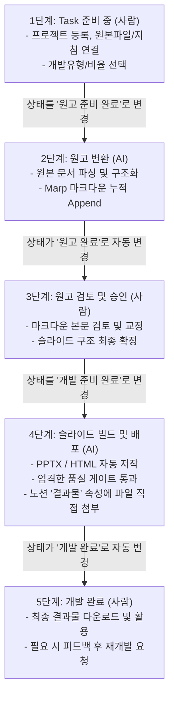

# [사용자 매뉴얼] 노션 연동 PPTX/HTML 자동화 파이프라인 가이드

본 매뉴얼은 노션(Notion)과 AI 저작 엔진을 결합하여, 강의·발표용 **고품질 PPTX 및 인터랙티브 HTML 웹 슬라이드**를 자동으로 제작하고 버전 관리하는 파이프라인의 표준 사용 설명서입니다.

처음 접하는 사용자도 본 매뉴얼과 노션의 **`NOTION PPT 개발 샘플`** 카드를 따라 하면 10분 이내에 자동화 슬라이드를 완성할 수 있습니다.

---

## 1. 설치 및 환경 설정 방법 (Installation & Setup)

파이프라인을 구동하기 위한 로컬 개발 환경 및 노션 연동 설정 절차입니다.

### 1.1 시스템 사전 요구사항
* **운영체제**: Windows 10/11, macOS, 또는 Linux
* **Python**: `Python 3.10` 이상 (Python 3.12 / 3.13 권장)
* **Node.js**: `Node.js 18` 또는 `20` 이상 (Playwright 브라우저 자동화용)
* **Git**: 최신 버전

### 1.2 소스코드 다운로드 및 필수 패키지 설치
터미널(PowerShell 또는 Bash)을 열고 프로젝트 폴더로 이동한 후 아래 명령어를 순서대로 실행합니다:

```bash
# 1. 저장소 클론 및 이동
git clone <저장소_URL>
cd SB-Make-Automation

# 2. 필수 파이썬 라이브러리 설치
pip install requests python-pptx playwright beautifulsoup4 marp-cli

# 3. HTML 슬라이드 비전 검증용 Playwright Chromium 브라우저 설치
npx playwright install chromium
```

### 1.3 노션 API 키 발급 및 `.env` 파일 설정
1. [Notion Developers 포털](https://developers.notion.com/)에 접속하여 로그인합니다.
2. **'새 API 통합(New Integration)'**을 클릭하고 이름을 입력(예: `PPT-Automation-Bot`)한 뒤 토큰을 생성합니다.
3. 생성된 **내부 통합 토큰(Internal Integration Secret)** 값(`ntn_...` 또는 `secret_...`)을 복사합니다.
4. 프로젝트 루트 디렉토리에 `.env` 파일을 생성하고 아래와 같이 저장합니다:
   ```env
   NOTION_TOKEN=ntn_your_notion_api_secret_key_here
   ```

### 1.4 노션 페이지 연결(Connections) 권한 부여
AI 봇이 노션 데이터베이스를 읽고 쓸 수 있도록 권한을 연결해야 합니다:
1. 노션 상위 대시보드 페이지인 **`NOTION-PPT`** 페이지로 이동합니다.
2. 페이지 우측 상단의 **`···` (더보기)** 아이콘을 클릭합니다.
3. 메뉴 하단의 **`연결(Connections)`** ➔ **`연결 추가(Add Connections)`**를 클릭합니다.
4. 앞서 생성한 통합(예: `PPT-Automation-Bot`)을 검색하여 선택 및 연결합니다.
   *(하위의 `PPT-Pipeline`, `PPT-Scripts`, `PPT-Guidelines` 데이터베이스에도 동일하게 연결되어 있는지 확인합니다.)*

---

## 2. 사용 방법 (5단계 라이프사이클: 사람 vs AI)

본 파이프라인은 사람의 기획·검토와 AI의 자동화 변환·빌드가 명확히 분리된 **5단계 라이프사이클**로 운영됩니다.



### 5단계 라이프사이클 상세 업무 분담표

| 단계 | 진행상태 명칭 | 주체 | 사람이 할 일 (User Action) | AI가 하는 일 (Agent Action) |
| :---: | :--- | :---: | :--- | :--- |
| **1** | **`Task 준비 중`** | **사람** | • `PPT-Pipeline`에 새 프로젝트 생성 (예: `NOTION PPT 개발 샘플`)<br>• `개발유형`(powerpoint / html) 및 `개발비율`(16:9 / 4:3) 선택<br>• `PPT-Scripts`에 원고 등록 (HWP/HWPX/DOCX/PDF/PPTX 첨부) 및 연결<br>• `PPT-Guidelines`에서 원하는 스타일(다크 테크, 스위스 미니멀 등) 연결<br>➔ 완료 후 진행상태를 **`원고 준비 완료`**로 변경 | • 일체 개입하지 않고 대기 (Skip) |
| **2** | **`원고 준비 완료`** | **AI** | • AI 작업이 끝날 때까지 대기 | • 사용자의 원고 변환 요청 트리거 수신<br>• `doc_parser.py` 메인 엔진으로 원본 문서 텍스트/표 파싱<br>• 70% 인포그래픽 구조화 Marp 마크다운 정제<br>• `PPT-Scripts` 본문 하단에 타임스탬프와 함께 누적(Append) 및 버전(v01➔v02) 갱신<br>➔ 진행상태를 **`원고 완료`**로 자동 갱신 |
| **3** | **`원고 완료`** | **사람** | • `PPT-Scripts`에 작성된 마크다운 원고를 직접 검토<br>• 오탈자 교정, 강조 문구 수정, 슬라이드 분할 등 자유롭게 편집<br>➔ 마크다운 검토가 완료되면 진행상태를 **`개발 준비 완료`**로 변경 | • 사용자의 검토를 기다리며 임의 실행 금지 (대기) |
| **4** | **`개발 준비 완료`** | **AI** | • AI 슬라이드 빌드 작업 대기 | • 사용자의 개발 요청 트리거 수신 (`"NOTION-PPT 개발해줘"`)<br>• `fetch`로 최신 마크다운 및 이미지 로컬 캐싱<br>• **PPTX**: 캔버스 SVG 직접 저작 ➔ `svg_quality_checker` 0 Errors 게이트 통과 ➔ PPTX 빌드 (4:3인 경우 16:9 와이드 변환본 동시 생성)<br>• **HTML**: 반응형 인터랙티브 웹 슬라이드 빌드 ➔ Playwright 실화면 캡처 ➔ 3대 비전 검증 게이트 통과<br>• 노션 공식 File Uploads API로 `결과물` 속성에 파일 직접 첨부(누적 Append)<br>➔ 진행상태를 **`개발 완료`**로 자동 갱신 |
| **5** | **`개발 완료`** | **사람** | • 노션 `결과물` 속성에서 완성된 파일 다운로드 및 검수<br>• 수정 사항 발생 시 피드백 작성 후 재개발 요청 | • 작업 완료 보고 후 대기 |

---

## 3. 개발 후 수정 요청 방법 (Change Request Protocol)

결과물을 검수한 후 내용을 보완하거나 디자인을 수정할 때 사용하는 표준 규칙입니다.

### 3.1 원고의 마크다운 수정 요청 방법
* **방법 A: 사용자가 직접 수정 (가장 빠름)**
  * 노션 `PPT-Scripts` 본문으로 이동하여 AI가 생성해 둔 마크다운을 직접 텍스트로 수정합니다.
  * 수정 완료 후, `PPT-Pipeline`의 상태를 바로 **`개발 준비 완료`**로 변경하고 `"수정한 원고로 다시 개발해줘"`라고 요청합니다.
* **방법 B: AI에게 원고 재정제 요청**
  * `PPT-Scripts` 본문 상단에 추가 요구사항을 적거나 원본 파일을 교체합니다.
  * 프로젝트 상태를 다시 **`원고 준비 완료`**로 변경하고 `"원고 다시 변환해줘"`라고 요청합니다.

### 3.2 결과물(PPTX / HTML)의 수정 요청 방법 (엄격한 피드백 프로토콜)
결과물 검수 후 특정 슬라이드의 레이아웃이나 스타일 수정을 요청할 때는 다음 규칙을 준수합니다:

1. **피드백 작성 위치**:
   * 노션 `PPT-Pipeline` 해당 프로젝트 페이지의 **본문(Page Body)**에 작성합니다.
2. **헤더 명명 규칙 (`## <최신_결과물_파일명>`)**:
   * 반드시 노션 `결과물` 속성에 첨부된 **가장 최신 파일명**을 `##` 헤더로 지정하고 하위에 요구사항을 작성합니다:
   ```markdown
   ## test_innovation_presentation_20261027_153553.pptx
   - [2번 슬라이드] 4대 장벽 카드의 테두리 강조색을 네온 블루(#3B82F6)로 변경
   - [4번 슬라이드] 4단계 로드맵 화살표 두께 확대 및 텍스트 2줄 래핑 조정
   - [오류 캡처] 5번 슬라이드 텍스트 겹침 현상 수정 요망 (스크린샷 첨부)
     (여기에 노션 이미지 붙여넣기 🖼️)
   ```
3. **최신 피드백 자동 인식 및 과거 이력 격리 원칙**:
   * AI는 `fetch` 시 가장 최신 파일명과 일치하는 `## <파일명>` 섹션만을 **"현재 활성 수정 요청"**으로 최우선 반영합니다.
   * 이전 버전 파일명(`## test_innovation_presentation_v1.pptx` 등) 하위의 피드백은 "과거 반영 완료 이력"으로 영구 보존되어 혼선이 발생하지 않습니다.
4. **재개발 실행 트리거**:
   * 피드백 작성이 끝나면, 보드 뷰에서 카드를 **`개발 완료` ➔ `개발 준비 완료`**로 이동시킵니다.
   * AI에게 `"피드백 반영해서 다시 개발해줘"`라고 요청하면, AI가 피드백을 반영한 새 파일을 빌드하여 노션 `결과물`에 **누적(Append)** 첨부하고 다시 `개발 완료`로 변경합니다.

---

## 4. 품질 검수 장치 (Quality Gates)

본 파이프라인에는 사람이 일일이 디자인 결함을 찾지 않아도 AI가 사전에 오류를 원천 차단하는 3중 자동 품질 검수 장치가 내장되어 있습니다.

### 4.1 PPTX 품질 검사 게이트 (`svg_quality_checker.py`)
PPTX로 변환되기 전, 모든 슬라이드 SVG 코드를 검사하여 **0 Errors (에러 0건)**를 달성해야만 빌드가 승인됩니다.
* **4대 검증 항목**:
  1. `viewBox` 규격: 선언된 화면 비율(16:9: `1280×720`, 4:3: `1024×768`)과 정확히 일치하는가?
  2. `spec_lock.md` 규약 동기화: 사용된 폰트 크기(px 단위 없는 순수 숫자), 컬러 팔레트가 선언과 일치하는가?
  3. **명도 대비(Contrast Ratio)**: 배경색 대비 텍스트 명도 대비가 최소 **4.5:1 이상**(WCAG AA 국제 표준)을 충족하여 가독성이 확보되었는가?
  4. **텍스트 오버플로우 방지**: 한글 34자 래핑 규칙 및 좌우/상하 안전 여백(Safe Margin)을 확보하여 텍스트가 카드 밖으로 삐져나가지 않는가?

### 4.2 HTML 슬라이드 실화면 비전 검증 게이트 (`capture_slides.py`)
웹 슬라이드(`html`)는 브라우저 엔진에 따라 여백이 왜곡될 수 있으므로, 배포 전 Playwright 기반 실화면 스크린샷 캡처 및 AI 비전 검증을 필수 통과해야 합니다.
* **검증 프로세스**:
  1. 1920×1080 와이드 고정 뷰포트에서 Slide 1부터 마지막 슬라이드까지 실제 렌더링 화면을 자동 캡처 (`temp/screenshots/slide_XX.png`).
  2. AI가 스크린샷 이미지를 시각적으로 직접 확인하여 **3대 기준** 검증:
     - **여백 점유율 (White Space Ratio)**: 카드/컨테이너 내부의 휑한 빈 공간이 **30% 이하**인가?
     - **비주얼 스케일 (Visual Scale)**: 삽입된 비주얼/차트/데이터 블록이 카드 높이의 **50% 이상**을 차지하며 시각적 균형을 이루는가?
     - **레이아웃 정합성**: 요소가 바닥이나 한쪽 구석으로 찌그러지지 않고 좌우 바닥선이 일치하는가?
  3. 기준 미달 시 노션 배포가 즉시 차단되며, 레이아웃 개편 후 재검증을 통과해야만 배포됩니다.

### 4.3 노션 공식 File Upload API 누적 배포 (Single Source of Truth)
* 구글 드라이브나 외부 클라우드 링크 방식은 파일 유실 위험이 있고 접근 권한 문제가 발생합니다.
* 본 파이프라인은 노션 공식 다단계 File Upload API(AWS S3 사전 서명 URL ➔ 바이너리 전송 ➔ 노션 파일 속성 바인딩)를 사용하여 노션 **`결과물` (Files & media)** 속성에 완성 파일을 직접 첨부합니다.
* 이전 버전 파일이 삭제되지 않고 시간 순서대로 **누적(Append)**되므로, 노션 페이지 하나에서 전체 버전 이력을 언제든 즉시 다운로드하여 비교할 수 있습니다.

---

## 5. 실전 따라하기: `NOTION PPT 개발 샘플` 튜토리얼

지금 노션 대시보드에서 **`NOTION PPT 개발 샘플`** 카드를 열어 직접 파이프라인을 체험해 보세요!

1. **카드 속성 확인**:
   - `개발유형`: `powerpoint`
   - `개발비율`: `16:9`
   - `개발지침`: `[스타일-스마트IT] 다크 테크 (Dark-Tech)`
   - `원고(마크다운)`: `AI를 활용한 업무 혁신 및 생산성 극대화 방안`
2. **원고 변환 트리거**:
   - 카드의 진행상태를 **`원고 준비 완료`**로 변경하고 AI에게 `"원고 변환해줘"` 요청.
   - AI가 변환을 마치면 상태가 **`원고 완료`**로 변경됩니다.
3. **원고 확인 및 승인**:
   - 연결된 원고 페이지에서 정제된 마크다운을 확인하고 이상이 없으면 상태를 **`개발 준비 완료`**로 변경.
4. **슬라이드 자동 개발**:
   - AI에게 `"NOTION-PPT 개발해줘"` 요청.
   - AI가 품질 검사를 거쳐 완성된 `.pptx` 파일을 `결과물` 속성에 첨부하고 상태를 **`개발 완료`**로 변경합니다.
5. **결과물 다운로드**:
   - `결과물` 속성에 생성된 PPTX를 열어 고품질 다크 테크 슬라이드를 확인합니다!
